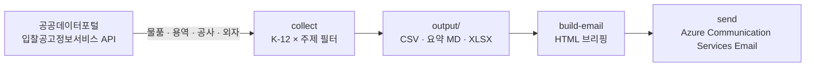

# public-procurement-agent

[](https://github.com/oneot/public-procurement-agent-kr/actions/workflows/ci.yml)
[](LICENSE)


조달청 **나라장터 입찰공고**를 자동으로 수집해 **K-12 교육기관**(시·도교육청 · 교육지원청 · 초·중·고)이
발주한 **AI · 소프트웨어 · 클라우드 · 보안 · PC** 관련 사업 기회만 골라내고, 리포트(CSV · Markdown · Excel)와
반응형 **HTML 이메일 브리핑**을 만들어 주는 도구입니다. GitHub Actions 로 매주 월요일 09:00(KST)에
자동 발송할 수 있습니다.

> English summary: [below](#english).

## 동작 방식



1. **수집** — 지난 N일(기본 7일, 어제까지) 등록된 물품 · 용역 · 공사 · 외자 입찰공고를 모두 조회합니다.
   일시적 오류(네트워크 · 타임아웃 · 429 · 5xx)는 지수 백오프로 재시도합니다.
2. **필터** — 공고기관/수요기관명이 K-12 교육기관인지(대학 · 병원 등 제외), 공고명에 초점 주제 키워드가
   있는지 판별합니다. 영문 대문자로 시작하는 키워드(`AI`, `SW` 등)는 대소문자를 구분하고,
   학교 이름에 들어간 주제어(예: "소프트웨어마이스터고")는 무시합니다. (공고번호, 차수) 중복은 제거합니다.
3. **리포트** — `output/` 에 CSV, 마크다운 요약, (선택) 엑셀을 저장합니다.
4. **브리핑** — 마감이 지나지 않은 공고를 마감 임박순(같으면 예산 큰 순)으로 정렬해 이메일용 HTML 을 만듭니다.
5. **발송** — Azure Communication Services(ACS) Email 로 보냅니다.

## 빠른 시작 (로컬)

### 1. 인증키 발급

1. [공공데이터포털](https://www.data.go.kr)에 가입하고
   [조달청_나라장터 입찰공고정보서비스](https://www.data.go.kr/data/15129394/openapi.do)에서 **활용신청**을 합니다
   (개발계정은 보통 자동 승인).
2. 마이페이지 → 개발계정에서 **일반 인증키**를 확인합니다. Decoding 키를 권장하지만 Encoding 키(`%2B` 등 포함)를
   넣어도 자동으로 처리합니다.

### 2. 설치와 실행

[uv](https://docs.astral.sh/uv/getting-started/installation/) 가 필요합니다 (Python 3.11 이상).

```bash
git clone https://github.com/oneot/public-procurement-agent-kr.git
cd public-procurement-agent-kr
uv sync --all-extras          # 엑셀(openpyxl) · 발송(ACS) 선택 기능 포함
cp .env.example .env          # NARA_SERVICE_KEY 값을 채우세요

uv run procurement-agent run  # 수집 → 리포트 → HTML 브리핑 (발송하지 않음)
open output/brief_latest.html # 결과 확인 (macOS)
```

pip 를 쓴다면 `pip install ".[xlsx,send]"` 후 `procurement-agent run` 으로 실행할 수 있습니다.

## 명령어

| 명령 | 설명 |
|---|---|
| `procurement-agent collect [--days N \| --date YYYYMMDD] [--min WON]` | 입찰공고 수집 → CSV · 요약 MD · XLSX |
| `procurement-agent build-email [CSV] [--date YYYYMMDD]` | CSV → HTML 브리핑 (CSV 생략 시 `output/` 의 최신 CSV) |
| `procurement-agent send [--html PATH] [--subject TEXT] [--dry-run]` | HTML 브리핑을 ACS Email 로 발송 |
| `procurement-agent run [수집 옵션] [--send]` | collect → build-email → (`--send` 시) send |

공통 옵션: `-c/--config TOML`(사용자 설정), `-o/--output-dir DIR`, `-v/--verbose`, `--version`.
종료 코드: `0` 성공, `1` 실행 실패(모든 API 호출 실패 · 발송 실패 등), `2` 설정/사용법 오류.

**출력 파일** (`output/`, 날짜는 KST 기준):

| 파일 | 내용 |
|---|---|
| `초중고교육청_입찰공고_YYYYMMDD.csv` | 최종 대상 공고 (UTF-8 BOM, 엑셀 호환) |
| `초중고교육청_요약_YYYYMMDD.md` | 한눈에 보기 + 예산순 목록 |
| `초중고교육청_입찰공고_YYYYMMDD.xlsx` | 예산순 엑셀 (`xlsx` extra 설치 시) |
| `초중고교육청_브리핑_YYYYMMDD.html`, `brief_latest.html` | 이메일 브리핑 |

> ⚠️ 리포트에는 공고 담당 공무원의 이름 · 연락처가 들어 있습니다. `output/` 은 `.gitignore` 에 포함되어 있으며,
> 공개 저장소에 커밋하거나 Actions 아티팩트로 올리지 마세요.

## 설정

기본 설정은 [`src/public_procurement_agent/default_config.toml`](src/public_procurement_agent/default_config.toml)에
있습니다(교육기관 키워드 · 제외어, 주제별 키워드, 최소 예산, 대형 기준 10억, API 재시도 등).
바꾸고 싶은 부분만 담은 TOML 파일을 `--config` 로 넘기면 **섹션 단위로 병합**되고, 지정한 키는 값 전체가 교체됩니다.

```toml
# my-config.toml — 예: 최근 14일, 5천만 원 이상, AI·보안만
[collect]
days = 14
min_budget = 50_000_000

[filters]
topic_label = "AI/보안"
topics = { AI = ["AI", "인공지능", "생성형"], "보안" = ["보안", "정보보호", "관제"] }
```

```bash
uv run procurement-agent --config my-config.toml run
```

### 환경변수

| 변수 | 필수 | 설명 |
|---|---|---|
| `NARA_SERVICE_KEY` | ✅ | 공공데이터포털 인증키 |
| `ACS_CONNECTION_STRING` | 발송 시 | ACS 리소스 연결 문자열 |
| `MAIL_SENDER` | 발송 시 | 보내는 주소 (예: `DoNotReply@<guid>.azurecomm.net`) |
| `MAIL_TO` | 발송 시 | 받는 사람 (쉼표 · 세미콜론 구분) |
| `BRIEF_BRAND_NAME` | | 헤더 · 푸터 로고 옆 이름 (기본: 없음) |
| `BRIEF_LOGO_URL` | | 로고 이미지 `https://` URL (기본: 없음) |
| `BRIEF_LOGO_MARK_COLORS` | | 이미지 없이 그리는 2×2 컬러 마크, `#RRGGBB` 4개 쉼표 구분 (기본: 없음) |
| `BRIEF_EYEBROW` | | 제목 위 작은 문구 (기본: `Weekly Korea K-12 Market Procurement Brief`) |
| `BRIEF_TITLE` | | 제목 (기본: `🇰🇷 K-12 Public Procurement Agent`) |
| `BRIEF_SECTION_LABEL` | | 카드 목록 위 문구 (기본: `✨ 이번주 주목할 주요 사업 기회 · 마감 임박순`) |
| `BRIEF_FOOTER_TEXT` | | 푸터 하단 문구 (기본: 없음) |
| `BRIEF_EMAIL_SUBJECT` | | 메일 제목 (기본: `WEEKLY KOREA K-12 MARKET PROCUREMENT BRIEF \| {date}`) |

브랜딩 문구에는 `{year}`, `{date}`(YYYY-MM-DD), `{brand_name}` 자리표시자를 쓸 수 있습니다.
환경변수는 설정 파일보다 우선하며, 빈 값은 무시됩니다. 로컬에서는 `.env` 파일도 읽습니다(셸 환경변수가 우선).

## GitHub Actions 배포

[`weekly_brief.yml`](.github/workflows/weekly_brief.yml)은 매주 월요일 00:00 UTC(= 09:00 KST)에
수집 → 브리핑 생성 → 발송을 실행합니다.

1. 저장소를 포크하거나 복제합니다. **포크/복제본에서는 워크플로의 저장소 조건
   (`if: github.repository == 'oneot/public-procurement-agent-kr'`)을 자신의 저장소 이름으로 바꿔야 실행됩니다.**
2. **Settings → Secrets and variables → Actions → Secrets** 에 등록합니다:
   `NARA_SERVICE_KEY`, `ACS_CONNECTION_STRING`, `MAIL_SENDER`, `MAIL_TO`.
3. (선택) `BRIEF_*` 브랜딩 값을 같은 화면의 **Secrets** 또는 **Variables** 탭에 등록합니다. 둘 다 있으면 Secrets 가
   우선합니다. **Variables 값은 공개 저장소의 Actions 로그에 가려지지 않고 그대로 출력**되므로, 공개하고 싶지 않은
   값은 Secrets 로 등록하세요(Secrets 는 로그에서 `***` 로 가려집니다). 예:
   ```bash
   gh secret set BRIEF_BRAND_NAME --body "My Team"
   gh secret set BRIEF_FOOTER_TEXT --body "© {year} My Team. All rights reserved."
   gh variable set BRIEF_EYEBROW --body "Weekly Brief"   # 공개돼도 괜찮은 값은 Variables 로도 충분합니다
   ```
4. **Actions → Weekly K-12 Procurement Brief → Run workflow** 로 수동 실행해 확인합니다.
   수동 실행은 기본이 **dry run**(수집 · 브리핑 생성만, 발송 안 함)이며, `send_email` 을 체크해야 발송합니다.
   예약 실행은 항상 발송합니다.

워크플로는 `contents: read` 권한만 쓰고, 인증키 · 발송 관련 비밀값은 필요한 단계에만 전달하며, 리포트를 아티팩트로
올리지 않습니다. 로그에는 수집 건수 · 수신자 수만 남고 서비스 키와 이메일 주소는 가려집니다.

> ℹ️ 공개 저장소에서는 **60일 동안 저장소 활동이 없으면 예약 워크플로가 자동으로 비활성화**됩니다.
> GitHub 알림 메일을 받으면 Actions 탭에서 다시 활성화하세요.

### Azure Communication Services(ACS) Email 준비

1. Azure Portal 에서 **Communication Services** 리소스와 **Email Communication Services** 리소스를 만듭니다.
2. Email 리소스에 **Azure 관리 도메인**(빠른 시작용) 또는 사용자 지정 도메인을 추가하고 검증합니다.
3. Communication Services 리소스의 **Email → Domains** 에서 그 도메인을 연결합니다.
4. Communication Services 리소스의 **Keys** 에서 연결 문자열을 복사해 `ACS_CONNECTION_STRING` 으로,
   도메인의 MailFrom 주소(예: `DoNotReply@<guid>.azurecomm.net`)를 `MAIL_SENDER` 로 등록합니다.

자세한 내용은 [ACS Email 빠른 시작](https://learn.microsoft.com/azure/communication-services/quickstarts/email/send-email)을 참고하세요.

## 문제 해결

- **`설정 오류: 환경변수 NARA_SERVICE_KEY 가 설정되지 않았습니다`** — `.env` 또는 셸 환경변수를 확인하세요.
- **`API 오류 (30 등록되지 않은 서비스키 / SERVICE_KEY_IS_NOT_REGISTERED_ERROR)`** — 활용신청 승인 전이거나
  키가 잘못되었습니다. 승인 직후에는 반영까지 시간이 걸릴 수 있습니다.
- **TLS 인증서 오류** — 이 도구는 인증서 검증을 끄지 않습니다. CA 번들은 [certifi](https://pypi.org/project/certifi/)
  를 사용하므로 macOS python.org 설치본의 인증서 문제도 영향을 받지 않습니다. 사내 프록시처럼 인증서가 바뀌는 환경이면
  `SSL_CERT_FILE` 로 신뢰할 CA 번들을 지정하세요.
- **일부 업무 구분만 실패** — 경고를 남기고 나머지로 브리핑을 만듭니다. 모든 업무 구분이 실패하면 종료 코드 1로
  끝나며 빈 브리핑을 발송하지 않습니다.

## 개발

```bash
uv sync --all-extras
uv run ruff check && uv run ruff format --check
uv run mypy
uv run pytest
```

테스트는 모두 합성(가짜) 데이터로 동작하며 네트워크를 쓰지 않습니다. 자세한 내용은 [CONTRIBUTING.md](CONTRIBUTING.md),
보안 신고는 [SECURITY.md](SECURITY.md)를 참고하세요.

## 데이터 출처와 면책

- 데이터 출처: [공공데이터포털](https://www.data.go.kr) — 조달청_나라장터 입찰공고정보서비스
  (이용허락범위: 제한 없음). 정확한 공고 내용은 반드시 [나라장터](https://www.g2b.go.kr) 원문으로 확인하세요.
- 이 프로젝트는 조달청(PPS) 또는 공공데이터포털과 **무관한 비공식 도구**이며, 결과의 정확성 · 완전성을 보장하지 않습니다.
  키워드 기반 필터이므로 누락이나 오탐이 있을 수 있습니다.
- 라이선스: [MIT](LICENSE)

---

## English

**public-procurement-agent** collects bid notices from Korea's public e-procurement system (KONEPS / 나라장터)
through the [data.go.kr BidPublicInfoService API](https://www.data.go.kr/data/15129394/openapi.do), keeps only
those issued by **K-12 education institutions** (provincial offices of education and primary/secondary schools)
that match **AI, software, cloud, security or PC** keywords, and produces CSV/Markdown/Excel reports plus a
responsive **HTML email brief**, optionally sent through **Azure Communication Services Email**. A GitHub Actions
workflow runs it every Monday at 09:00 KST.

```bash
uv sync --all-extras
cp .env.example .env                 # set NARA_SERVICE_KEY (data.go.kr API key)
uv run procurement-agent run         # collect → reports → HTML brief (no email)
uv run procurement-agent run --send  # ...and send it (needs ACS_CONNECTION_STRING, MAIL_SENDER, MAIL_TO)
```

Defaults (keywords, exclusions, thresholds) live in `default_config.toml` and can be overridden with
`--config my.toml`; email branding can be set with `BRIEF_*` environment variables. In GitHub Actions, set them
as repository secrets or variables (secrets win). Use secrets for anything that shouldn't appear in public logs,
because variable values are printed unmasked. Manual workflow runs are dry runs unless `send_email` is checked.
This is an unofficial tool, not affiliated with the Public Procurement Service (PPS) or data.go.kr. Licensed under
MIT.
